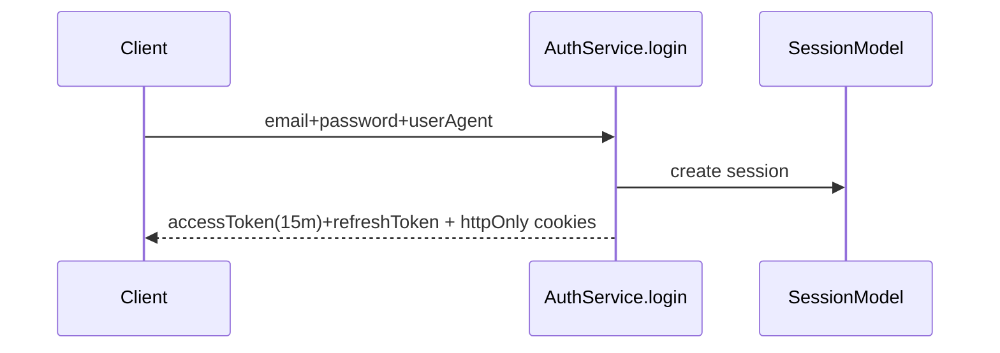
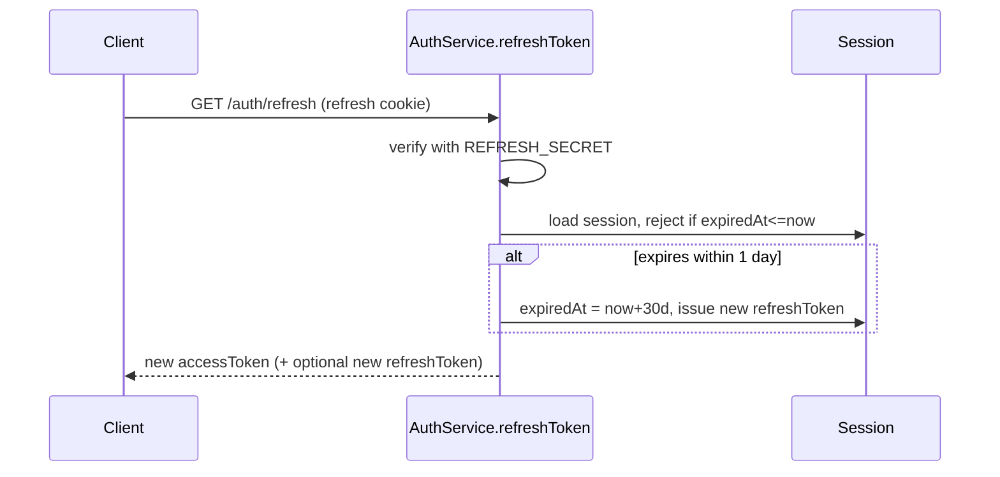
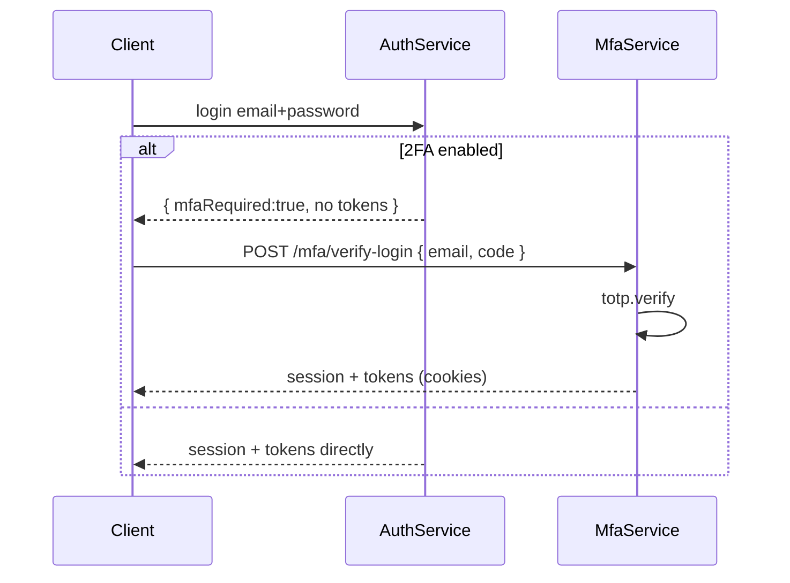

# Taskflow — Full Project Doc

**One sentence:** a multi-tenant task manager (mini-Linear) — users form workspaces (orgs),
orgs hold projects, projects hold kanban tasks, teammates collaborate with comments; v2/v3 add
notifications, admin, search, and file uploads.

This is the **single source of truth**: features, build order, security internals, API contract and
status all live here. If this doc and the repo disagree, the repo wins and this doc gets fixed in
the same commit.

## Contents

1. [Stack](#1-stack)
2. [Repo layout](#2-repo-layout)
3. [Current status + working agreement](#3-current-status--working-agreement)
4. [How this codebase works (read once)](#4-how-this-codebase-works-read-once)
5. [Features](#5-features)
6. [Build order](#6-build-order)
7. [v2 — queues, notifications, admin](#7-v2--queues-notifications-admin)
8. [v3 — search and files](#8-v3--search-and-files)
9. [Security deep-dive](#9-security-deep-dive)
10. [Endpoint reference](#10-endpoint-reference)
11. [File index](#11-file-index)
12. [Working method](#12-working-method)
13. [Troubleshooting](#13-troubleshooting)
14. [Glossary](#14-glossary)

---

## 1. Stack

| Layer    | Tech |
|----------|------|
| Backend  | Express 4 + Mongoose 8 + Zod, TypeScript (`express-backend/`, `tsx watch src/index.ts`) |
| Auth     | Passport-JWT (access cookie) + DB sessions + TOTP MFA (`speakeasy` + `qrcode`) + Resend mail |
| Frontend | Next.js + axios `withCredentials` + react-hook-form/Zod + TanStack Query (`next-frontend/`) |
| Later    | BullMQ + Redis (v2 queues), `vitest + supertest + mongodb-memory-server` (phase 6), Docker (ops) |

## 2. Repo layout

```
task_flow/
├── express-backend/           # the API
│   ├── src/
│   │   ├── index.ts           # mounts every router (auth §6.0, session, mfa, orgs, projects, tasks, …)
│   │   ├── config/            # app.config.ts (JWT, BASE_PATH, origin), http.config.ts (status codes)
│   │   ├── database/
│   │   │   ├── database.ts
│   │   │   └── models/        # user, session, verification, org, membership, project, task, …
│   │   ├── modules/           # auth, mfa, session, user, organization, project, task, …
│   │   ├── common/            # validators, utils, strategies, enums, interfaces
│   │   ├── middlewares/       # asyncHandler, errorHandler, passport, require-org-*
│   │   ├── mailers/           # mailer.ts, resendClient.ts, templates/
│   │   └── queues/            # v2 only
│   ├── package.json
│   └── tsconfig.json
├── next-frontend/             # the app (parked until phase 5)
└── PROJECT.md                 # this file — start here
```

## 3. Current status + working agreement

**Last updated: phase 4 code complete (build green, runtime pending — no Mongo yet).**

| Phase | What | State |
|-------|------|-------|
| 0 | Auth gap fixes (token signing, reset route, session delete verb, cookie flags, branding) | ✅ done |
| 1 | Orgs + members + invites (`/orgs`, `/invites`) | ✅ committed (`1462c3c`) |
| 2 | Projects (CRUD inside orgs, `?archived=`) | ✅ committed (`1464ee6`) |
| 3 | Tasks: board, move state machine (`todo→doing→done`), float order | ✅ code committed (`1464ee6`), ⚠️ **never built or exercised since** |
| 3.5 | Tasks cleanup: cascade, per-status `order`, nullable assignee, first real build | ✅ done — build green |
| 4 | Comments + auto-activity feed | ✅ code complete — runtime verification blocked on Mongo |
| 5 | Wire/verify frontend against the API | ⏸ **deferred** — backend first |
| 6 | Ops: logging, health, tests, Docker, CI (v1 close) | ❌ after 4 |
| v2 | Queues, in-app notifications, admin + audit | ❌ |
| v3 | Full-text search, or S3/R2 file uploads | ❌ |

**Why things are "unverified":** `express-backend/node_modules` was empty until phase 3.5, and no
database has been running since. `tsc` is now green for phases 3.5 + 4, but no endpoint has been
exercised at runtime. Nothing is known to be broken — nothing is known to be green either.

**Working agreement (how this build is run):**

- **Backend first.** No frontend work until v1 backend is done. Only `next-frontend/lib/api.ts`
  is read, and only as the frozen response contract.
- **Implementation split.** From phase 4 onward the agent writes the code and the project owner
  reviews each diff before commit. Phases 0–3.5 were mentor-led (owner wrote, agent reviewed).
- Each step is **predict → attempt → verify with real command output → commit**. No commit with
  a red `npm run build`.
- **One file per step.** If a step touches three files, it is three steps.
- Every new mutation gets a "can user B do this?" check before it counts as done.
- No new dependency without one sentence saying why the current approach fails.

**What's live today:** full auth (register/login/logout, sliding 15m/30d httpOnly cookies,
session list/revoke, TOTP MFA, email verify, password forgot/reset); orgs (create, list mine,
members CRUD with roles, leave, single-use 7-day invites); projects (create/list per org,
rename/archive, admin-only delete with task cascade); tasks (board, filters, state-machine moves,
per-status order, assign/unassign); comments + activity feed. Everything from tasks onward is
build-verified but not yet runtime-verified.

## 4. How this codebase works (read once)

### 4.1 Request lifecycle

```
Client → route (*.route.ts) → Zod validator → auth middleware → controller → service → Mongoose model
                                                                                    → errorHandler
```

- **Route** (`src/modules/<name>/<name>.route.ts`): URL + verb + which controller runs.
  Example: `session.route.ts` — `GET /all`, `GET /single`, `DELETE /:id`.
- **Validator** (`src/common/validators/*.ts`): Zod schemas, e.g. `registerSchema` in
  `auth.validators.ts`. Rejects bad input with 400 before any DB work.
- **Middleware**: `authenticateJWT` (`src/common/strategies/jwt.strategy.ts`) reads the
  `accessToken` httpOnly cookie, loads the user, sets `req.sessionId`. Applied at mount time in
  `src/index.ts`.
- **Controller** (`*.controller.ts`): thin — pulls `req.user/params/body`, calls the service, sets
  cookies/status.
- **Service** (`*.service.ts`): all business logic + DB calls. 80% of the work happens here.
- **Module** (`*.module.ts`): wires controller + service singletons.
- **Errors**: throw `AppError` subclasses (`src/common/utils/catch-error.ts`);
  `src/middlewares/errorHandler.ts` maps Zod → 400, `AppError` → its status, else 500.

### 4.2 The pattern to copy for every feature

```
src/database/models/<name>.model.ts         # Mongoose schema
src/modules/<name>/<name>.route.ts          # verbs + paths
src/modules/<name>/<name>.controller.ts     # thin HTTP layer
src/modules/<name>/<name>.service.ts        # logic + queries
src/modules/<name>/<name>.module.ts         # singleton wiring
src/common/validators/<name>.validators.ts  # Zod input schemas
# mount in src/index.ts: app.use(`${BASE_PATH}/<name>`, authenticateJWT, <name>Routes)
```

### 4.3 Auth model you must not break

- Access JWT 15m + refresh JWT 30d, both in **httpOnly cookies** (`src/common/utils/cookie.ts`,
  `src/config/app.config.ts`). The frontend never touches tokens — `axios withCredentials` sends
  them automatically.
- Every JWT carries a `sessionId`; logout deletes that row, reset-password deletes **all** rows
  for the user. That is how "revocable JWTs" work here.
- MFA gate: if `userPreferences.enable2FA`, login returns `{ mfaRequired: true }` with **no
  cookies**; `POST /mfa/verify-login` issues them after the TOTP check.
- Single-use codes: email-verify (45m) and password-reset (1h) rows are `deleteOne()`d on use;
  forgot-password is rate-limited (max 2 per 3 min → 429).

### 4.4 The golden rule (multi-tenancy)

> **Every SaaS query filters by `orgId`. Miss once = tenant leak (user B sees org A's data).**

Concretely: `Task.find({ _id: tid, orgId })`, never `Task.findById(tid)`. Membership is checked
first (is this user in this org?), then the data query carries `orgId`. Repeating this in every
phase is deliberate. No membership → **404, never 403** — don't confirm an org exists to outsiders.

## 5. Features

### A. Auth (done — keep as-is)

Register/login/logout, sliding refresh 15m/30d, session list/revoke, TOTP setup/verify/revoke +
`mfaRequired` gate, email verify (45m), forgot (2 per 3 min) + reset (1h, kills all sessions),
Zod validation, `httpOnly` cookies + `withCredentials`.

### B. Orgs + members (done)

- `Org{name, ownerId}`, `Membership{orgId, userId, role: admin|member}` with a **unique compound
  index** on `(orgId, userId)`.
- `POST /orgs` (creator = admin), `GET /orgs` (mine, via membership join), `GET /orgs/:id/members`,
  `PUT /orgs/:id/members/:uid`, `DELETE /orgs/:id/members/:uid`, `POST /orgs/:id/leave`.
- Invite: `POST /orgs/:id/invite {email}` → `Verification{type=ORG_INVITE, 7d}` + mail;
  `POST /invites/accept {code}` — invited email must match the logged-in user, single-use.

### C. Projects (done)

- `Project{orgId indexed, name, archived:false}` — `archived` is soft-delete; the list hides
  archived by default and nothing is hard-deleted except explicit admin delete.
- `POST/GET /orgs/:id/projects` (`?archived=&page=&limit=`, cap 50), `PUT/DELETE /projects/:pid`.

### D. Tasks (code done, unverified)

- `Task{projectId indexed, orgId indexed, title, desc?, status: todo|doing|done,
  priority: low|med|high, assigneeId?, dueAt?, order}`.
- `POST /projects/:pid/tasks`, `GET /projects/:pid/tasks?status=&assignee=&search=&page=&limit=`
  (`.lean()`, `sort({order:1})`, cap 50), `PUT /tasks/:tid`, `PUT /tasks/:tid/move`,
  `DELETE /tasks/:tid`.
- State machine: adjacent moves only (`todo→doing`, `doing→todo`, `doing→done`, `done→doing`);
  `todo→done` is a 400.
- v2 backlog: bulk assign.

### E. Collaboration (next — phase 4)

- `Comment{taskId indexed, orgId indexed, authorId, body}` — create/list per task, delete by
  author or org admin.
- `Activity{taskId, orgId, actorId, action: created|moved|assigned|commented, detail?, at}` —
  server-written on every mutation; `GET /tasks/:tid/activity` newest-first.

### F. Notifications (v2)

- BullMQ + Redis: invite mail, assign mail, due-soon digest. Reuses `mailer.ts` and the
  `userPreferences.emailNotification` flag (exists today, unused).
- In-app: `Notification{userId, type, refId, read}` + `GET /notifications`,
  `PUT /notifications/:id/read`, `PUT /notifications/read-all`.

### G. Search + files (v3, pick one first)

- Search: Mongo text index on `Task.title` + `desc`, `GET /orgs/:id/search?q=`, always org-scoped.
- Files: avatar/attachment upload via S3/R2 presigned URL. Pick one, not both.

### H. Admin + audit (v2)

- `User.role: user|admin`, `requireRole('admin')` middleware after `authenticateJWT`.
- `GET /admin/users?page=&limit=&search=`, `PUT /admin/users/:uid/role`, `GET /admin/audit?action=`.
- `Audit{actorId, action, ip, userAgent, at}` on login/logout/reset/MFA/invite/task-move.

### I. Frontend (built, parked until phase 5)

- `/(main)/orgs` (list/create/switch), `/org/[id]/board` (3 kanban columns, drag → `move`),
  `/org/[id]/members` (invite + role select), `/home` dashboard, sessions + MFA pages.
- Same `axios withCredentials`, extend `middleware.ts` guard to `/org/*`, same RHF+Zod,
  TanStack Query per board column.

### J. Ops (phase 6)

- `pino-http` + request-id, replace `console.error` in `errorHandler.ts`; `GET /health`,
  `GET /ready` (Mongo ping).
- `vitest + supertest + mongodb-memory-server` regression suite (details in §6.7).
- `Dockerfile` + `docker-compose` (mongo + redis + api), Swagger from Zod at `/docs`, seed script,
  GitHub Actions (`tsc --noEmit`, test, build).

### v1 cut

**A + B + C + D (move + filters) + E (comments + activity) + J.** Then v2 = F + H, v3 = G.

Deliberately skipped until needed: estimates, hand-written index DDL, API payload examples.

## 6. Build order

One phase at a time. Finish the done criteria before opening the next. The order is
load-bearing: orgs → projects → tasks → comments → (frontend) → ops → v2 → v3.

### 6.0 Phase 0 — Fix known auth gaps — ✅ DONE

Why first: the frontend already called the *correct* shapes, so these were live 404s/wrong verbs.

| # | Fix | File |
|---|-----|------|
| 1 | Access/refresh tokens signed with swapped options — copy the pattern from `mfa.service.ts` | `src/modules/auth/auth.service.ts` |
| 2 | Wire missing `POST /auth/password/reset` | `src/modules/auth/auth.route.ts` |
| 3 | Session delete: `GET /:id` → `DELETE /:id`; scope delete to the current user | `session.route.ts`, `session.service.ts` |
| 4 | Enable `secure` + `sameSite` cookie flags in production | `src/common/utils/cookie.ts` |
| 5 | Rename issuer `squeezy.com` → Taskflow | `mfa.service.ts`, `src/mailers/templates/` |

**Done criteria:** ✅ `POST /auth/password/reset` wired; `DELETE /session/:id` scoped to user;
login sets both cookies; `tsc --noEmit` clean. Token-signing fix shipped as part of the `jwt.ts`
verify-result refactor. Commit `fix: auth route gaps (phase 0)`.

### 6.1 Phase 1 — Orgs + members + invites — ✅ DONE (`1462c3c`)

**Concepts:** an `Org` is a workspace. A `Membership` row says "user X belongs to org Y with role
Z". Roles: `admin` (invite, change roles, remove) vs `member` (read/write tasks). Invites reuse the
`VerificationCode` model with type `ORG_INVITE` (7-day expiry) — same single-use `deleteOne()`
pattern as email verification.

**Files:** `src/database/models/org.model.ts` (Org + Membership, unique compound
`(orgId, userId)`), `src/modules/organization/*`, `src/common/validators/org.validators.ts`,
`ORG_INVITE` in `src/common/enums/verification-code.enum.ts`.

**Endpoints:**

| Method | Path | Who | Behavior |
|--------|------|-----|----------|
| `POST` | `/orgs` | any user | Create org; creator gets `Membership{role:admin}`. Body `{"name":"Acme"}` |
| `GET` | `/orgs` | any user | List orgs where I have a membership (join, not just `ownerId`) |
| `GET` | `/orgs/:id/members` | member | Memberships + user basics |
| `PUT` | `/orgs/:id/members/:uid` | admin | Change role. Body `{"role":"admin"}` |
| `DELETE` | `/orgs/:id/members/:uid` | admin | Remove member; can't remove self if last admin → 400 |
| `POST` | `/orgs/:id/leave` | member | Leave org; same last-admin guard |
| `POST` | `/orgs/:id/invite` | admin | `ORG_INVITE` (7d) + mail with accept link |
| `POST` | `/invites/accept` | any user | `findOne({code, type, expiresAt:$gt now})`; email must match; create membership; `deleteOne()` |

**Middleware pattern reused everywhere:** `requireOrgMember` and `requireOrgAdmin`
(`src/middlewares/require-org-*.middleware.ts`). They load `Membership{orgId, userId}`, **404** if
none, attach `req.membership`, call `next()`.

**Done criteria:** ✅ creator is admin; `GET /orgs` shows only my orgs; B `GET /orgs/<A-id>/members`
→ 404; invite accepts once, second accept fails; different logged-in email rejected; non-admin
role change → 403; last-admin remove/leave → 400. Commit `feat: orgs + members + invites`.

### 6.2 Phase 2 — Projects — ✅ DONE (`1464ee6`)

**Concept:** a project is a task container inside one org (a board).

**Files:** `src/database/models/project.model.ts`, `src/modules/project/*`,
`src/common/validators/project.validators.ts`. Mounted at `/orgs/:id/projects` (nested, behind
`requireOrgMember`) and `/projects/:pid` (top-level, membership checked in the service).

**Endpoints:**

| Method | Path | Who | Behavior |
|--------|------|-----|----------|
| `POST` | `/orgs/:id/projects` | member | Body `{"name":"Website"}` |
| `GET` | `/orgs/:id/projects` | member | `?archived=false&page=1&limit=20` (cap 50) |
| `PUT` | `/projects/:pid` | member | Rename / archive; `pid` must belong to an org I'm in |
| `DELETE` | `/projects/:pid` | admin | Delete project + its tasks (cascade — see 3.5) |

**Done criteria:** ✅ files exist and are mounted (`src/index.ts`); committed in `1464ee6`.
⚠️ Caveat: `DELETE /projects/:pid` does **not** cascade tasks yet — phase 3.5 fixes it.

### 6.3 Phase 3 — Tasks, the core — ✅ code complete (`1464ee6`), UNVERIFIED

**Concepts:** a task lives in exactly one project **and** carries a denormalized `orgId` (both
indexed — `orgId` is what enforces tenancy without a join on every read). `status` is a **state
machine**: adjacent moves only; skipping `todo → done` is a 400 — the frontend board relies on
this. `order` is a float: insert between two tasks by averaging their orders, no renumbering.

**Endpoints:**

| Method | Path | Who | Behavior |
|--------|------|-----|----------|
| `POST` | `/projects/:pid/tasks` | member | Create (status `todo`, `order` = max+1). Verify project ∈ my org |
| `GET` | `/projects/:pid/tasks` | member | `?status=&assignee=&search=&page=&limit=` — `.lean()`, `sort({order:1})`, cap 50 |
| `PUT` | `/tasks/:tid` | member | Edit title/desc/priority/assignee/due (NOT status) |
| `PUT` | `/tasks/:tid/move` | member | `{"status":"doing","order":1.5}` — adjacency enforced, else 400 |
| `DELETE` | `/tasks/:tid` | member | Delete task (+ its comments) |

**Done criteria (all still unverified):**

- [ ] `todo → done` direct → 400; legal moves → 200.
- [ ] Board returns sorted by `order`, max 50 rows, `.lean()`.
- [ ] Cross-org `PUT /tasks/<other-org-tid>` → 404.
- [ ] Assignee must be an org member, else 400.

Landing note: shipped early as part of `1464ee6` rather than its own commit; the commit message
`feat: tasks + board + move state machine` was used for the projects+tasks batch.

### 6.4 Phase 3.5 — Tasks cleanup — ✅ DONE (build green, runtime pending)

**Step 1 — baseline.** `cd express-backend && npm install && npm run build`. Do not change code
first: whatever the build says is the true state of `1464ee6`. Paste the output. If clean, that
baseline is trustworthy for the rest of v1.

**Step 2 — project delete must not orphan tasks.** `project.service.ts:49-54` deletes the project
row and leaves tasks pointing at a dead `projectId`. Answer before coding: if you delete by
`projectId` only, what cross-org risk are you accepting? Write the filter with `orgId` in it,
remove the `ponytail` comment, and order the deletes so a crash can't leave tasks behind a
project that no longer exists.

**Step 3 — `order` is per column, not per project.** `task.service.ts:47-50` uses
`max(all tasks in project)+1`, so columns inherit each other's gaps. Scope the lookup to the
status being created into. Justify the cold-start value (`last?.order ?? 0` + 1 → first task is
`1`, which reads better in debugging than `0`).

**Step 4 — allow unassigning.** `task.validators.ts:18` + `task.service.ts:81-93`. `assigneeId`
can be omitted but never cleared. Accept `null` as "unassign" and keep `undefined` as "leave
alone" — different intents. In the service `null` must become `$unset`, not
`$set: { assigneeId: null }` (a `null` still matches `{ assigneeId: null }` queries and will bite
you in phase 4). `null` must skip the `assertOrgMember` check.

**Step 5 — prove it with two users.** A creates org → project → 3 tasks. Then: B's cookie on A's
`pid` → 404; `todo → done` → 400; `todo → doing` → 200; `GET .../tasks?limit=999` → 50 items;
three new tasks have `order` 1, 2, 3 in `todo` (not 1, 4, 7).

**Done criteria:** build clean, all five checks pass, `git diff` has no unrelated edits.
Commit `fix: task/project cascade + per-status order`.

### 6.5 Phase 4 — Comments + activity — ✅ CODE COMPLETE, runtime unverified (closes v1 backend)

**Concepts:** `Comment` is user content; `Activity` is an automatic trail the **server** writes on
every mutation — never trust the client to log itself.

**Teaches:** denormalized read models, permission checks that aren't `authorId === me`, and
fire-and-forget side effects.

**Step 1 — `comment.model.ts`.** `taskId` + `orgId` indexed, `authorId`, `body` max 2000,
timestamps. Why does a comment need its own `orgId` when `taskId` leads to one? (One query
instead of a join on every permission check.)

**Step 2 — `activity.model.ts`.** `{taskId, orgId, actorId, action, detail?, at}`. Add a compound
index for the read pattern — order the fields by how the feed is queried and sorted.

**Step 3 — `logActivity` helper.** Put it in `activity.service.ts` so it imports only its model
(no cycle with task/comment). It must never throw into the caller: `.catch(log)` + `void` at the
call site. Be ready to explain why `await` here is a design mistake even though it "works".

**Step 4 — comment module.** Four files + validator. `POST`/`GET /tasks/:tid/comments` reuse the
`getTaskForUser` membership pattern (`task.service.ts:136-145`) — outsiders get 404, not 403.
`DELETE /comments/:cid`: load comment → derive `orgId` → look up membership → allow if
`authorId === me` **or** `role === "admin"`; no membership → 404, member-but-not-author → 403.

**Step 5 — activity module.** Read-only `GET /tasks/:tid/activity`, newest first, paginated,
membership-scoped. No HTTP writes — activity is a server-side side effect only.

**Step 6 — wire the four events.** `created` in `createTask`; `moved` in `moveTask` with
`detail: "todo → doing"`; `assigned` in `updateTask` **only when the value changed** (compare
before `$set`, including the `null` case from 3.5); `commented` in the comment service. Trap:
comparing after the update means you can never see the old assignee.

**Step 7 — cascade.** `task.service.ts:121` → delete comments and activity for that task, scoped by
`orgId`.

**Step 8 — mount.** Both routers in `src/index.ts` under `${BASE_PATH}` with `authenticateJWT`.
Check for path collisions with the existing `taskRoutes` mount first.

**Step 9 — verify with curl.** No comment UI exists, so keep a `docs/http/comments.http` or
`scripts/smoke.sh`. Evidence required: create → move → comment leaves 3 activity rows in the right
order; B cannot read or delete A's comments (404); a non-author member can't delete (403); the
author can; an org admin can delete someone else's.

**Done criteria:** 3 activity rows, author/admin delete, outsider 404, build clean.

> **Status:** implemented — `comment.model.ts`, `activity.model.ts`, both modules, validators,
> task-service wiring (`created`/`moved`/`assigned`), delete cascades, and the `${BASE_PATH}`
> mounts. `tsc` is green. **Runtime is unverified** because no Mongo was running; work through
> `express-backend/docs/http/comments.http` once it is.
>
> Implementation notes worth reviewing: `logActivity` is synchronous-void and swallows errors
> (`activity.service.ts`); delete permission derives membership from the comment's own `orgId`,
> returning 404 for outsiders and 403 for members who are neither author nor admin; `assigned`
> compares the pre-update value, so `null` logs `unassigned`; task delete removes comments and
> activity before the task row.

Commit: `feat: comments + activity`.

### 6.6 Phase 5 — Frontend wiring — ⏸ DEFERRED

Not started by decision (backend first). For when it resumes: the frontend was built against
exactly the contract in §10.

| Page | Calls | Working = |
|------|-------|-----------|
| `/orgs` | `GET/POST /orgs` | Create org → appears → Board/Members buttons route to `/org/<id>/…` |
| `/org/[id]/board` | `GET /orgs/:id/projects`, `POST …/projects`, `GET /projects/:pid/tasks?status=`, `POST …/tasks`, `PUT /tasks/:tid/move`, `DELETE /tasks/:tid` | Project select fills; 3 columns fill; drag **or** `→status` moves a card; ✕ deletes |
| `/org/[id]/members` | `GET …/members`, `POST …/invite`, `PUT …/members/:uid`, `DELETE …/members/:uid` | Invite → member appears after accept; role select persists; Remove works |
| `/home` | `GET /orgs`, `GET /session/all`, MFA state | Stat cards + recent workspaces + Security card |
| Sidebar/Header | `GET /orgs` | Workspace group + Board/Members links; switcher navigates |

Also outstanding on that side (from the old security doc): `next-frontend/middleware.ts` had
`forgot-password`/`reset-password` matchers missing their leading `/`, and `getUserSessionQueryFn`
called `GET /session/` instead of `GET /session/single`. Verify both in phase 5.

### 6.7 Phase 6 — Ops + tests (v1 close) — ❌ after 4

Do these in order; each is small.

1. **Observability:** `pino-http` + request-id middleware; replace `console.error` in
   `src/middlewares/errorHandler.ts`; the request id must appear in the error log line.
2. **Health:** `GET /health` (always 200, no DB) and `GET /ready` (200 only when Mongo `ping`
   succeeds, 503 otherwise). Be able to explain the difference.
3. **Tests** (`vitest` + `supertest` + `mongodb-memory-server`), in this order:
   - register → login → refresh round-trip
   - MFA gate: login returns `mfaRequired`, sets **no** cookies, until TOTP verify
   - **golden rule:** B gets 404 on A's org / members / projects / tasks / comments / activity
   - `todo → done` → 400; `todo → doing` → 200
   - invite accept twice → second fails
   - last-admin remove/leave → 400
   - comment delete: author 200, other member 403, outsider 404
4. **Docker:** `Dockerfile` (`npm run build` + `start`) + `docker-compose.yml` (mongo, redis, api)
   + `scripts/seed.ts` producing a demo org/project/3 tasks. Seed must be idempotent. Note:
   `npm run build` runs `tsc && cp ./package.json ./dist` — `cp` breaks on Windows; the Docker
   image is Linux so it's fine there, but fix or document it for Windows contributors.
5. **Swagger** at `/docs` from the existing Zod schemas (`@asteasolutions/zod-to-openapi` — the
   only new v1 dep). Justify it or ship a static OpenAPI file.
6. **CI:** GitHub Actions — backend `tsc --noEmit`, `test`, `build`. Leave the frontend lint job
   out (broken on TS 7 vs `eslint-config-next`) until phase 5.

**v1 definition of done:** A + B + C + D + E + J, deployed and used. Then v2.

## 7. v2 — queues, notifications, admin

Both need the v1 data model stable first, and both introduce infrastructure or cross-cutting
concerns that are painful to retrofit mid-v1.

### 7.1 Queue foundation (do this first — everything rides on it)

**Concept:** some work must not block the HTTP response. Sending an email takes ~1s; doing it
inside `POST /invite` hangs the UI and loses the mail if the server dies mid-send. A **queue**
(BullMQ + Redis) stores the job durably and a **worker** delivers it with retries.

New deps: `bullmq`, `ioredis`. Docker: add `redis` (compose first, code second).

```
src/queues/queue.ts               # shared connection + queue factory
src/queues/mail.queue.ts          # "mail" queue: { to, subject, html }
src/queues/workers/mail.worker.ts # concurrency 5, 3 retries with backoff
```

Reuse `src/mailers/mailer.ts` + Resend inside the worker (not the route). Routes **enqueue**
(`await mailQueue.add("send", {...})`) and return immediately.

**Done criteria:** stop Redis → invite still 200 (job waits); start Redis → mail arrives; worker
logs show a retry on forced failure.

### 7.2 Notification triggers

Enqueue (never send inline) on:

| Event | Recipient | Payload |
|-------|-----------|---------|
| Org invite (§6.1) | invited email | accept link + org name + inviter |
| Task assigned (§6.3, `assigneeId` set/changed) | assignee | task title + project + link — **only if** `userPreferences.emailNotification` |
| Due-soon digest | each user with tasks `dueAt` within 24h | one daily summary, not one mail per task (BullMQ repeatable job `0 8 * * *`) |

### 7.3 In-app notifications

**Concept:** email is unreliable as UI (spam, delay). A `Notification` row lets the frontend render
unread state instantly.

`Notification{userId indexed, type: invite|assigned|due|comment, refId, read:false, timestamps}`.
Write it in the same service call that enqueues mail (same `if`, two writes).

| Method | Path | Behavior |
|--------|------|----------|
| `GET` | `/notifications?unreadOnly=&page=` | Mine only, newest first |
| `PUT` | `/notifications/:id/read` | Mark one; verify `userId` = me |
| `PUT` | `/notifications/read-all` | Mark all mine |

Frontend (later): bell in `Header.tsx` with unread count, dropdown, click → mark read + navigate.
Poll every 30s; no WebSocket in v2.

**Done criteria:** assign a task → assignee has an unread row + gets mail (if opted in); digest
sends once daily per user, not per task.

### 7.4 Admin + audit

**Concepts:** `User.role: user|admin` (default `user`; first admin seeded). `requireRole('admin')`
runs **after** `authenticateJWT`. `Audit` rows are append-only and server-written.

`Audit{actorId, action: login|logout|password_reset|mfa_enabled|invite_sent|task_moved|role_changed, ip, userAgent, at}`.
Written from the login/logout/reset/MFA/invite/task-move services with the same fire-and-forget
helper pattern as §6.5.

| Method | Path | Who | Behavior |
|--------|------|-----|----------|
| `GET` | `/admin/users?page=&limit=&search=` | `admin` | Search by name/email |
| `PUT` | `/admin/users/:uid/role` | `admin` | Promote/demote (can't demote self) |
| `GET` | `/admin/audit?page=&action=` | `admin` | Filterable audit feed |

**Done criteria:** non-admin `GET /admin/users` → 403; every login/logout/reset/invite/move leaves
an audit row with ip + userAgent.

Commit trail: `feat: queues + mail worker` → `feat: in-app notifications` → `feat: admin + audit`.

## 8. v3 — search and files

Standalone value-adds with no v2 dependency. Ship one, learn, then the other.

### Option A — Full-text search (recommended first: no new infra)

Mongo's `text` index lets `find({$text:{$search:"land"}})` match "landing page" without scanning.

1. Add `taskSchema.index({ title: "text", desc: "text" })`.
2. `GET /orgs/:id/search?q=&type=tasks&page=` — **always** `{orgId, $text:{$search:q}}`; projects
   match `{orgId, name:/q/i}`. Cap 20. Sort by score (`{$meta:"textScore"}`).
3. Frontend later: search input in `Header.tsx` → `/org/[id]/search?q=` reusing board cards.

**Done criteria:** "land" finds "Landing page" in my org and zero rows from other orgs; empty `q`
→ 400, never a full-table dump.

### Option B — Files: avatars + task attachments (needs object storage)

Never store files in Mongo. The server mints a short-lived **presigned URL**; the browser uploads
straight to S3/R2; you save the returned key.

New deps: `@aws-sdk/client-s3`, `@aws-sdk/s3-request-presigner`. Env: `S3_BUCKET`, `S3_REGION`,
`S3_ACCESS_KEY`, `S3_SECRET_KEY` (Cloudflare R2 uses the same SDK with another endpoint).

```
1. Client: POST /uploads/presign { filename, contentType, kind: avatar|attachment }
   → server checks membership, returns { uploadUrl (PUT, 5min), key, publicUrl }
2. Client: PUT uploadUrl <bytes>            (direct to S3, API not involved)
3. Client: PUT /users/me { avatarKey }  or  POST /tasks/:tid/attachments { key, filename, size }
   → server stores the key (never trusts a client-provided publicUrl)
```

Rules: 5 MB cap, allowlist `image/*, application/pdf` validated server-side at presign,
attachments listed on the task card, avatars via the `Avatar` fallback chain.

**Done criteria:** upload works without hitting API payload limits; forged keys from another org
rejected; deleting a task removes its attachment rows (S3 objects via lifecycle rule or worker —
document which).

## 9. Security deep-dive

Code-first: each section says what it is → where it lives → how it works here.

Stack: `Express 4 + Mongoose 8 + Passport-JWT + jsonwebtoken + bcrypt + speakeasy + qrcode + Zod +
cookie-parser + cors` (backend `package.json`), `Next.js + axios(withCredentials) + RHF + Zod +
TanStack Query` (frontend `package.json`).

### 9.1 Password hashing (`bcrypt`, salt 10)

`src/common/utils/bcrypt.ts`:

```ts
export const hashValue = (value, saltRounds = 10) => bcrypt.hash(value, saltRounds);
export const compareValue = (value, hashed) => bcrypt.compare(value, hashed);
```

`src/database/models/user.model.ts`:

```ts
userSchema.pre("save", async function (next) {
  if (this.isModified("password")) this.password = await hashValue(this.password);
  next();
});
userSchema.methods.comparePassword = function (v) { return compareValue(v, this.password); };
```

- Register (`auth.service.ts`) relies on `pre("save")`.
- Reset hashes manually because `findByIdAndUpdate` skips hooks.
- Leak prevention: `toJSON` deletes `password` and `userPreferences.twoFactorSecret`.

Learn: never store plaintext, never return hash/secret in responses.

### 9.2 JWT: 15m access + 30d refresh

`src/config/app.config.ts`: `JWT = { SECRET, EXPIRES_IN:"15m", REFRESH_SECRET, REFRESH_EXPIRES_IN:"30d" }`.

`src/common/utils/jwt.ts`:

```ts
type AccessTPayload = { userId; sessionId };
type RefreshTPayload = { sessionId };
const defaults = { audience: ["user"] };
```

`signJwtToken(payload, options)` and `verifyJwtToken()` — the latter returns `{ error }` instead
of throwing, so the caller must check `payload`.

Login issues both:

```ts
const session = await SessionModel.create({ userId, userAgent });
const accessToken  = signJwtToken({ userId, sessionId: session._id });          // access options
const refreshToken = signJwtToken({ sessionId }, refreshTokenSignOptions);      // refresh options
```

Refresh with sliding window:

```ts
const { payload } = verifyJwtToken(refreshToken, { secret: refreshTokenSignOptions.secret });
if (session.expiredAt <= now) throw Unauthorized("Session expired");
if (session.expiredAt - now <= ONE_DAY_IN_MS) {
  session.expiredAt = calculateExpirationDate(REFRESH_EXPIRES_IN); // extend
  newRefreshToken = signJwtToken({ sessionId }, refreshTokenSignOptions);
}
```





### 9.3 Cookies + CORS (no localStorage tokens)

`src/common/utils/cookie.ts`:

```ts
export const REFRESH_PATH = `${BASE_PATH}/auth/refresh`; // refresh cookie only sent there
const defaults = { httpOnly: true, secure: isProd, sameSite: "lax" }; // prod flags enabled in phase 0
getRefreshTokenCookieOptions() // { httpOnly, expires: 30d, path: REFRESH_PATH }
getAccessTokenCookieOptions()  // { httpOnly, expires: 15m, path: "/" }
```

`src/index.ts`: `cors({ origin: APP_ORIGIN, credentials: true })`, `cookieParser()`,
`passport.initialize()`.

Frontend `lib/axios-client.ts`: `axios.create({ withCredentials: true, timeout: 10000 })` — the
browser sends httpOnly cookies automatically, JS never reads them (XSS-safe storage).

Learn: `httpOnly` blocks `document.cookie` theft; `path=/auth/refresh` shrinks refresh-token
exposure; `secure + sameSite` matter in prod.

### 9.4 Request auth: Passport-JWT from cookie

`src/common/strategies/jwt.strategy.ts`:

```ts
jwtFromRequest: ExtractJwt.fromExtractors([(req) => {
  const t = req.cookies.accessToken;
  if (!t) throw new UnauthorizedException("Unauthorized access token", AUTH_TOKEN_NOT_FOUND);
  return t;
}]),
secretOrKey: JWT.SECRET, audience: ["user"], algorithms: ["HS256"], passReqToCallback: true
```

Verify: `findUserById(payload.userId)`, set `req.sessionId = payload.sessionId`. Export
`authenticateJWT = passport.authenticate("jwt", { session: false })`.
`src/middlewares/passport.ts` registers the strategy; `src/index.ts` mounts it per router.

Learn: stateless JWT check + stateful session id inside the token = revocable JWTs.

### 9.5 Server sessions (revocable logins, multi-device)

`src/database/models/session.model.ts`: `{ userId(ref User, indexed), userAgent?, expiredAt: 30d }`.

- Create on login / MFA-login.
- Logout: `findByIdAndDelete(sessionId)` — kills one device.
- Reset password: `deleteMany({ userId })` — kills all devices.
- List: only `expiredAt: { $gt: now }`, flagging `isCurrent`.
- Frontend sessions UI splits current/other via `parse-useragent.ts` (`UAParser` + `date-fns`),
  delete → `DELETE /session/:id`.

Learn: JWT alone can't logout; the DB session row gives you logout + "active sessions".

### 9.6 MFA TOTP (`speakeasy + qrcode`)

`user.model.ts`: `userPreferences { enable2FA:false, emailNotification:true, twoFactorSecret? }`.

Setup:

```ts
const secret = speakeasy.generateSecret({ name: "Taskflow" });
user.userPreferences.twoFactorSecret = secret.base32; await user.save();
const url = speakeasy.otpauthURL({ secret, label: user.name, issuer: "Taskflow", encoding: "base32" });
const qrImageUrl = await qrcode.toDataURL(url);
```

Enable: `speakeasy.totp.verify({ secret, encoding: "base32", token: code })` → `enable2FA=true`.
Revoke: clear secret + `enable2FA=false`.

Login gate: if `enable2FA`, return `{ user:null, mfaRequired:true }` — no tokens yet.
`verifyMFAForLogin` re-verifies TOTP, then creates the session + both tokens.



### 9.7 Email verification + password reset

`verification.model.ts`: `{ userId(indexed), code(unique, default uuid), type, expiresAt }`.
Types: `EMAIL_VERIFICATION | PASSWORD_RESET | ORG_INVITE`.

- Register: create `EMAIL_VERIFICATION/45m`, mail `${APP_ORIGIN}/confirm-account?code=`.
- Verify: `findOne({ code, type, expiresAt: $gt now })`, set `isEmailVerified:true`,
  `deleteOne()` (single-use).
- Forgot: 404 if no user; rate-limit max 2 `PASSWORD_RESET` per 3 min (`threeMinutesAgo` →
  `429 AUTH_TOO_MANY_ATTEMPTS`); create 1h code, mail `reset-password?code=&exp=`.
- Reset: validate code + expiry, `hashValue(password)`, `deleteOne()` code, `deleteMany` sessions.

Learn: single-use + expiring codes, enumeration-safe errors, reset kills all sessions.

### 9.8 Validation + errors

`src/common/validators/auth.validators.ts`:

```ts
emailSchema = z.string().trim().email().min(1).max(255);
passwordSchema = z.string().trim().min(6).max(255);
registerSchema = z.object({ name, email, password, confirmPassword }).refine(pw === confirmPw);
loginSchema, verificationSchema, resetPasswordSchema
```

`mfa.validator.ts`: `code max 6`, `secretKey` / `email+userAgent`.

`src/middlewares/errorHandler.ts`: `ZodError → 400 { Validation failed, errors:[{field,message}] }`,
`SyntaxError → 400`, `AppError → statusCode + errorCode`, else `500`. Codes in
`src/common/enums/error-code.enum.ts`, statuses in `src/config/http.config.ts`.

Frontend mirrors with RHF + `@hookform/resolvers/zod` (sign-in, sign-up with confirm match,
forgot, reset with `exp` check, verify-mfa).

### 9.9 Frontend route guard + auto-refresh

`next-frontend/middleware.ts`: `protected=[/home,/sessions]`, reads `req.cookies.get("accessToken")`,
protected+no-cookie → `/`, public+cookie → `/home`.

`axios-client.ts`:

```ts
if (data.errorCode === "AUTH_TOKEN_NOT_FOUND" && status === 401) {
  await APIRefresh.get("/auth/refresh");
  return APIRefresh(error.config); // retry once
} catch { window.location.href = "/"; }
```

`hooks/use-auth.ts` + `context/auth-provider.tsx`: `useQuery(["authUser"], GET /session/, staleTime: Infinity)`.

### 9.10 Security gaps — status

Fixed in phase 0: swapped token options (access/refresh), missing `POST /auth/password/reset`,
session delete via `GET` (now `DELETE`, user-scoped), `secure`/`sameSite` still commented out,
`squeezy.com` issuer branding.

Still open:

| Gap | Where | Fix |
|-----|-------|-----|
| No `helmet` | `src/index.ts` | Add `helmet()` before routers |
| No global rate limit | app-wide | Forgot-password is the only limited route; add a coarse limiter at least on `/auth/*` |
| `verifyJwtToken` swallows error detail | `src/common/utils/jwt.ts` | Log the underlying error; never surface it to the client |
| Frontend middleware matchers missing leading `/` | `next-frontend/middleware.ts` | Phase 5 |
| `getUserSessionQueryFn` calls `GET /session/` | `next-frontend/lib/api.ts` | Phase 5 — use `GET /session/single` |
| No audit trail | — | v2 §7.4 |

## 10. Endpoint reference

Base: `${BASE_PATH}` = `/api/v1`. Auth: 🟢 public · 🔒 JWT cookie · 🛡 org role.
Every 🔒 SaaS route also enforces membership → 404 for outsiders.

### 10.1 Auth, MFA, sessions (v1, done)

| Method + Path | Auth | Body | Result |
|---|---|---|---|
| `POST /auth/register` | 🟢 | `{name,email,password,confirmPassword}` | User (hash via pre-save) + `EMAIL_VERIFICATION/45m` mail |
| `POST /auth/login` | 🟢 | `{email,password}` + user-agent | `Session` + both httpOnly cookies, or `{mfaRequired:true}` with no cookies |
| `POST /mfa/verify-login` | 🟢 | `{email,code≤6}` + user-agent | `totp.verify` → session + cookies |
| `GET /auth/refresh` | 🍪 refresh | — | New access cookie (+ sliding refresh if <1d left) |
| `POST /auth/verify/email` | 🟢 | `{code}` | `isEmailVerified=true`, single-use `deleteOne` |
| `POST /auth/password/forgot` | 🟢 | `{email}` | ≤2/3min else 429; `PASSWORD_RESET/1h` mail |
| `POST /auth/password/reset` | 🟢 | `{password,verificationCode}` | New hash, code consumed, all sessions deleted |
| `POST /auth/logout` | 🔒 | — | Delete this session, clear both cookies |
| `GET /mfa/setup` | 🔒 | — | `{secret, qrImageUrl}` (data URL) |
| `POST /mfa/verify` | 🔒 | `{code≤6,secretKey}` | `enable2FA=true` |
| `PUT /mfa/revoke` | 🔒 | — | Clear secret, `enable2FA=false` |
| `GET /session/all` | 🔒 | — | Non-expired sessions, `isCurrent` flagged |
| `GET /session/single` | 🔒 | — | Current user |
| `DELETE /session/:id` | 🔒 | — | Revoke one device session (scoped to me) |

### 10.2 SaaS (v1)

| Method + Path | Auth | Body / Query |
|---|---|---|
| `POST /orgs` / `GET /orgs` | 🔒 | `{name}` / — |
| `GET /orgs/:id/members` | 🔒 member | — |
| `PUT /orgs/:id/members/:uid` | 🔒 admin | `{role}` |
| `DELETE /orgs/:id/members/:uid` | 🔒 admin | — |
| `POST /orgs/:id/leave` | 🔒 member | — (last-admin guard) |
| `POST /orgs/:id/invite` | 🔒 admin | `{email}` |
| `POST /invites/accept` | 🔒 | `{code}` (email must match) |
| `POST /orgs/:id/projects` / `GET …` | 🔒 member | `{name}` / `?archived=&page=&limit=` |
| `PUT /projects/:pid` / `DELETE …` | 🔒 member / admin | `{name?,archived?}` |
| `POST /projects/:pid/tasks` | 🔒 member | `{title,desc?,priority?,assigneeId?,dueAt?}` |
| `GET /projects/:pid/tasks` | 🔒 member | `?status=&assignee=&search=&page=&limit=` (cap 50) |
| `PUT /tasks/:tid` | 🔒 member | `{title?,desc?,priority?,assigneeId?,dueAt?}` — never status |
| `PUT /tasks/:tid/move` | 🔒 member | `{status,order?}` (adjacent only) |
| `DELETE /tasks/:tid` | 🔒 member | — |
| `POST/GET /tasks/:tid/comments` | 🔒 member | `{body}` / `?page=&limit=` (oldest-first) |
| `DELETE /comments/:cid` | 🔒 author/admin | — |
| `GET /tasks/:tid/activity` | 🔒 member | — (newest-first) |

### 10.3 v2

`GET /notifications?unreadOnly=&page=` · `PUT /notifications/:id/read` ·
`PUT /notifications/read-all` (all 🔒 self) ·
`GET /admin/users?page=&limit=&search=` · `PUT /admin/users/:uid/role {role}` ·
`GET /admin/audit?page=&action=` (all 🔒 `admin` role).

### 10.4 v3

`GET /orgs/:id/search?q=&type=&page=` (🔒 member) ·
`POST /uploads/presign {filename,contentType,kind}` (🔒 member) ·
`POST /tasks/:tid/attachments {key,filename,size}` · `GET /tasks/:tid/attachments` ·
`PUT /users/me {avatarKey?}`.

## 11. File index

Where each job lives today, and where new ones go.

```
express-backend/src/
├── index.ts                       # mounts (add v2/v3 mounts here)
├── config/
│   ├── app.config.ts              # JWT, BASE_PATH, origin (+ S3/Redis in v2/v3)
│   └── http.config.ts             # status codes
├── database/
│   ├── database.ts
│   └── models/
│       ├── user.model.ts          # + role field in v2
│       ├── session.model.ts
│       ├── verification.model.ts  # + ORG_INVITE
│       ├── org.model.ts           # Org + Membership (unique orgId+userId)
│       ├── project.model.ts
│       ├── task.model.ts          # + text index in v3
│       ├── comment.model.ts       # phase 4
│       ├── activity.model.ts      # phase 4
│       ├── notification.model.ts  # v2
│       └── audit.model.ts         # v2
├── modules/
│   ├── auth/ mfa/ session/ user/
│   ├── organization/ project/ task/
│   ├── comment/ activity/         # phase 4
│   ├── notification/ admin/       # v2
│   └── upload/ search/            # v3
├── common/
│   ├── validators/
│   ├── strategies/jwt.strategy.ts
│   ├── utils/{bcrypt,cookie,jwt,uuid,date-time,AppError,catch-error,get-env}.ts
│   └── enums/{error-code,verification-code}.enum.ts
├── middlewares/                   # asyncHandler, errorHandler, passport, require-org-*
├── mailers/{mailer,resendClient}.ts, templates/
└── queues/                        # v2 (queue.ts, mail.queue.ts, workers/)
```

Security job map: hashing → `common/utils/bcrypt.ts` + `user.model.ts`; JWT →
`common/utils/jwt.ts` + `config/app.config.ts`; cookies → `common/utils/cookie.ts` + auth/mfa
controllers; passport gate → `middlewares/passport.ts` + `common/strategies/jwt.strategy.ts` +
`index.ts`; sessions → `models/session.model.ts` + `modules/session/*`; MFA → `modules/mfa/*` +
`validators/mfa.validator.ts`; verify/reset → `models/verification.model.ts` + `modules/auth/auth.service.ts`
+ `mailers/*`; validation/errors → `validators/auth.validators.ts` + `middlewares/errorHandler.ts`
+ `common/utils/{AppError,catch-error}.ts` + `config/http.config.ts`.

## 12. Working method

1. **One phase at a time.** Finish its done criteria before opening the next. The order is
   load-bearing: orgs → projects → tasks → comments → frontend → ops → v2 → v3.
2. **Test with two users.** Isolation bugs only show with A *and* B (two browsers/incognito).
   Every phase: "can B see A's stuff?" → must be 404.
3. **Use the frontend as the test UI later**; until phase 5, curl/`httpie` + the phase-6 suite are
   the feedback loop.
4. **Commit per phase**, push, and keep the status table in §3 current as you land.
5. **Per-commit checklist:**
   - [ ] `npm run build` clean (paste output)
   - [ ] two-user isolation case worked for every new endpoint
   - [ ] no `ponytail` TODO left in a touched file
   - [ ] `git diff` reviewed hunk by hunk, no stray formatting churn
   - [ ] commit message from this doc, imperative, one block of work
   - [ ] doc updated in the same commit if reality changed

## 13. Troubleshooting

| Symptom | Cause | Fix |
|---------|-------|-----|
| 404 on `/orgs` etc. | Backend phase not built | Build §6.1 first |
| 401 `AUTH_TOKEN_NOT_FOUND` then redirect `/` | Access cookie expired, refresh failed | `GET /auth/refresh` must succeed — check cookies/phase 0 |
| 403 on role change | Logged in as member, not admin | Promote via DB or use the creator account |
| Board empty but no error | Wrong `projectId`, or tasks in another project | Check `pid` + `?status=` in devtools |
| Invite accept fails | Email mismatch or code reused/expired | Log in as the invited email; codes are single-use |
| `npm run build` fails on `cp` | Windows has no `cp` | Use `tsc --noEmit` locally; Docker (Linux) is fine |
| 404 on a task you can see in Mongo | Missing `orgId` filter / wrong org | Golden rule §4.4 |

## 14. Glossary

- **Tenant / multi-tenancy:** one app serving many orgs whose data must never mix. `orgId` on
  every row is the mechanism.
- **Membership:** the join row proving user X is in org Y (with a role). No membership = 404.
- **Sliding refresh:** refresh expiry extends when used near expiry (30d window, extend if <1d
  left).
- **TOTP:** time-based one-time password (authenticator app, 6 digits, `speakeasy`).
- **Single-use code:** verification row deleted on use; replay → 404.
- **State machine (tasks):** only adjacent status moves allowed; the server rejects skips.
- **`.lean()`:** Mongoose returns plain objects instead of documents — faster for reads.
- **Presigned URL:** short-lived upload ticket minted by your server, used directly against S3.
- **Worker/queue:** background job processing (BullMQ + Redis) so HTTP responses stay fast.
- **Audit vs Activity:** Activity = per-task feed (members see it); Audit = global admin trail
  (admins only).
- **`ponytail` TODO:** a marker left in code for a deferred cascade/behavior that a later phase
  must close (both current ones are listed in §6.4).
